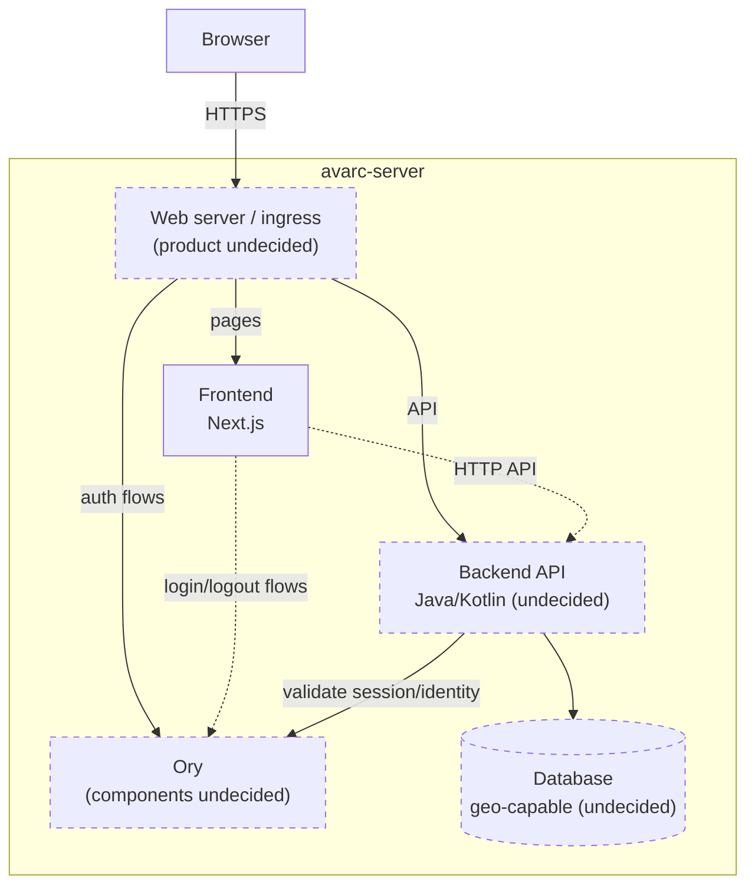

# Architecture diagram

Source of truth for the system diagram required by
[SPEC-architecture-diagram.md](SPEC-architecture-diagram.md). Dashed borders
mark undecided components. Each sub-application (frontend, backend, Ory
setup, ingress) may have its own, more detailed architecture diagram next to
its code.

