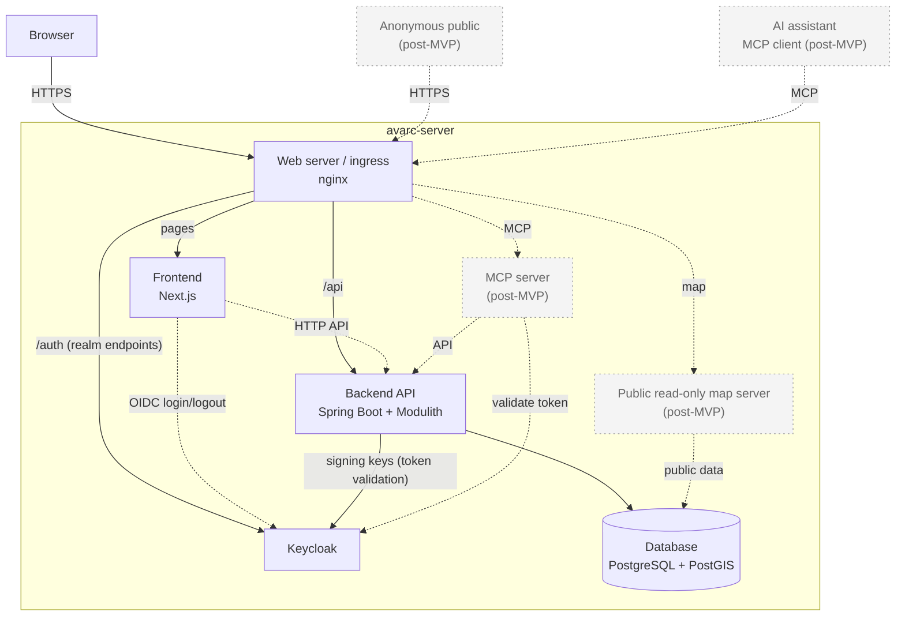

# Architecture diagram

Source of truth for the system diagram required by
[SPEC-architecture-diagram.md](SPEC-architecture-diagram.md). Dashed borders
mark undecided components; dotted, muted borders mark components planned for
after the MVP. Dotted arrows are connections whose route is not decided yet
or that belong to post-MVP components. Each sub-application (frontend, backend, Keycloak
setup, ingress) may have its own, more detailed architecture diagram next to
its code.

