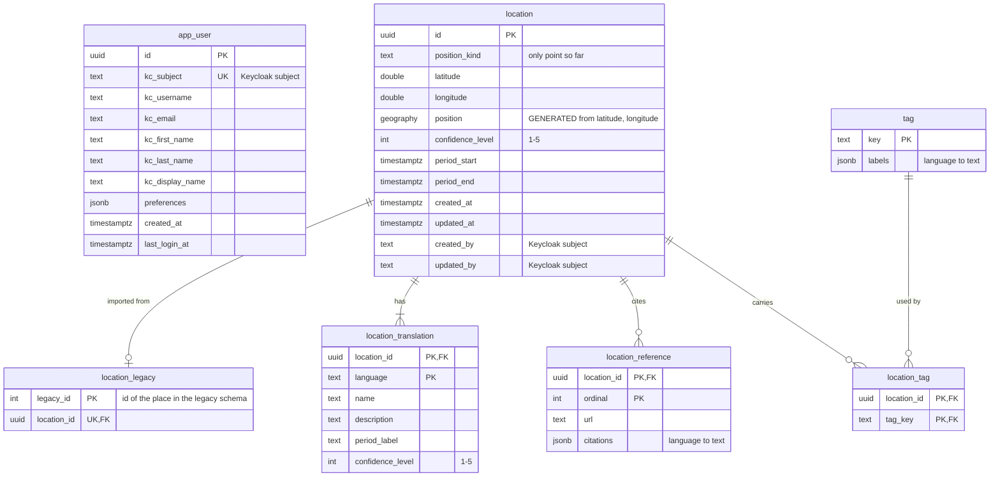

# Data model diagram

Source of truth for the diagram required by
[SPEC-datamodel-diagram.md](SPEC-datamodel-diagram.md): the tables of the
schema `avarc`, as the Flyway migrations in
`avarc-server-backend/src/main/resources/db/migration` create them. The
logical model is in [SPEC-locations.md](SPEC-locations.md) and
[SPEC-users.md](SPEC-users.md). `GENERATED` marks a column the database
computes; the application does not touch it. Current up to migration
`V4__location_legacy.sql`.

`location.created_by`, `location.updated_by` and `app_user.kc_subject` hold the
same Keycloak subject but are not linked by a foreign key.
