# Legacy data model diagram

The tables of the schema `legacy`, loaded from the Access export with
`deploy/import-sql.sh` (see [SPEC-deployment.md](SPEC-deployment.md)); the
subject of [AVARC-50](../tasks/TASK-legacy-import.md). The current model of
the application is in [datamodel-diagram.md](datamodel-diagram.md).

The export has primary keys only, no foreign keys. The relations drawn here
are inferred from column names and checked against the data of the stage
database (no orphan rows for the relations of `poh`, `payload_poh`,
`sources_poh`, `poh2keyword` and `timelinecluster`; the rest are by name only). Row counts are those of that
database. Tables that hold personal data are marked and shown without their
columns' content; the import reads only the contributor link.

Findings that matter for the import:

- `poh.pohType_ID` refers to `pohtype.identifier`, not to `pohtype.ID`.
- Every place has exactly one `georeference_poh` row (3,516 of 3,518; two
  coordinate rows are unused). All `srid` are 4326. Latitude and longitude
  are text, and 8 rows are not plain decimals.
- `payload_poh` has `DE` for every place and `GB` for 2; the code for English
  is `GB`, not `EN`. 57 places have an empty `poh.description`.
- `poh.maincategory` is empty for 3,511 places; the other values include URLs
  and `ToDo`, so it is not a clean category. `pohcategory` holds only `ToDo`.
- Two distinct contributors appear in `poh`; `contributor` has 5 rows.
- The timeline tables hold one row each (one place), the evaluation tables
  are lookup data with 30 evaluations, and `address`, `person`, `poh2person`
  and `sources_tl`/`sources_ts` are empty.

```mermaid
erDiagram
    poh {
        int ID PK
        varchar code
        varchar name
        text description
        int georeference_poh_ID FK
        int contributor_ID FK
        int pohType_ID FK "refers to pohtype.identifier"
        text avarc_notes
        varchar maincategory "mostly empty"
        varchar secondarycategory
        varchar CountryPresent "2 letters"
        varchar city
        varchar street
        varchar street_addon
        int zip
        int ID_old
        int georeference_ID_old
    }

    georeference_poh {
        int ID PK
        int ID_old
        varchar name
        varchar longitude "text"
        varchar latitude "text"
        int tmpPohType
        varchar tmpDescription
        varchar country
        varchar source
        timestamp creation
        varchar srid "all 4326"
    }

    payload_poh {
        int ID PK
        int poh_ID FK
        varchar language "DE, GB"
        varchar name
        text description
        text briefing
        varchar avarc_name
        varchar avarc_webname
        varchar avarc_notes
        varchar info1
        varchar info2
        varchar info3
    }

    pohtype {
        int ID PK
        int identifier "referenced by poh"
        varchar description "21 rows"
    }

    pohcategory {
        varchar pohcategory "only ToDo"
    }

    contributor {
        int ID PK
        varchar Name "personal data"
        varchar code
    }

    address {
        int ID PK
        int contributor_ID FK "personal data, empty"
    }

    sources_poh {
        int ID PK
        int poi_id FK
        varchar source_type FK
        text source
        text description
    }

    source_type {
        varchar sourcetype
    }

    keywords {
        varchar keyword
    }

    poh2keyword {
        varchar keyword FK
        int poh_ID FK
    }

    timelinecluster {
        int ID PK
        int poh_ID FK
        timestamp begin
        timestamp end
        varchar begin_aux
        varchar end_aux
        text notes
    }

    timeline {
        int ID PK
        int timelinecluster_ID FK
        int position
        int type
        timestamp begin
        timestamp end
        varchar begin_aux
        varchar end_aux
        text notes
    }

    timesegment {
        int ID PK
        int timeline_ID FK
        int position
        timestamp duration
        timestamp begin
        timestamp end
        varchar begin_aux
        varchar end_aux
        int timesegment_id FK "self reference"
        varchar predecessors
        text notes
    }

    payload_tc {
        int ID PK
        int timelinecluster_id FK
        varchar title
        varchar description
        varchar language
    }

    payload_tl {
        int ID PK
        int timeline_id FK
        varchar title
        varchar description
        varchar language
    }

    payload_ts {
        int ID PK
        int timesegment_id FK
        varchar title
        varchar description
        varchar language
    }

    sources_tl {
        int ID PK
        int poi_id FK "timeline, empty"
        varchar source_type
        text source
        text description
    }

    sources_ts {
        int ID PK
        int poi_id FK "timesegment, empty"
        varchar source_type
        text source
        text description
    }

    evaluation {
        int ID PK
        int poh_id FK
        smallint evaluations_Type_ID FK
        smallint grade
    }

    evaluation_Type {
        int ID PK
        varchar type
        varchar description
    }

    evaluations {
        int ID PK
        int evaluation_type_id FK
        int grade
        varchar tag
        varchar description
    }

    poh_evalAccess {
        int evalAccess_ID FK
        int poh_ID FK
    }

    evalAccess {
        smallint ID PK
        varchar Tag
        varchar Description
    }

    collection {
        int ID PK
        varchar title
        text description
        int contributor_id FK
        varchar notes
    }

    collectionItem {
        int ID PK
        int collection_ID FK
        int poh_id FK
        int contributor_poh_id
        int index
        varchar info
    }

    poh2author {
        int ID PK
        int poh_id FK
        int author_id FK
        varchar change
        timestamp changedate
    }

    author {
        int ID PK
        varchar Name1 "personal data"
        varchar Name2
        varchar Name3
        varchar description
        varchar country
    }

    poh2person {
        int ID PK
        int poh_id FK
        int person_id FK
        varchar person_role FK
        varchar role_info
    }

    person {
        int ID PK
        varchar Name1 "personal data, empty"
    }

    person_role {
        varchar relation
    }

    poh2attribute {
        int ID PK
        int poh_id FK
        int attribute_id FK
    }

    attribute {
        int ID PK
        varchar attribute
        varchar type FK
        varchar data
        int subordinateTo
    }

    attributes {
        varchar attribute
        varchar type
    }

    attributeTypes {
        varchar attributeType
    }

    user {
        int ID PK
        varchar username "personal data"
        varchar password "credential, never read"
    }

    mapzero {
        int id PK
        varchar name
        varchar latitude
        varchar longitude
    }

    sphere {
        int ID PK
        varchar name
        text abstract
    }

    iso_3166_1 {
        varchar Alpha2 "table iso-3166-1, 249 rows"
        varchar Alpha3
        varchar englishName
    }

    poh }o--|| georeference_poh : "georeference_poh_ID"
    poh }o--|| contributor : "contributor_ID"
    poh }o--|| pohtype : "pohType_ID = identifier"
    payload_poh }o--|| poh : "poh_ID"
    sources_poh }o--|| poh : "poi_id"
    sources_poh }o--o| source_type : "source_type"
    poh2keyword }o--|| poh : "poh_ID"
    poh2keyword }o--|| keywords : "keyword"
    address }o--|| contributor : "contributor-ID"
    timelinecluster }o--|| poh : "poh_ID"
    timeline }o--|| timelinecluster : "timelinecluster_ID"
    timesegment }o--|| timeline : "timeline_ID"
    payload_tc }o--|| timelinecluster : "timelinecluster_id"
    payload_tl }o--|| timeline : "timeline_id"
    payload_ts }o--|| timesegment : "timesegment_id"
    sources_tl }o--|| timeline : "poi_id"
    sources_ts }o--|| timesegment : "poi_id"
    evaluation }o--|| poh : "poh_id"
    evaluation }o--|| evaluation_Type : "evaluations_Type_ID"
    evaluations }o--|| evaluation_Type : "evaluation_type_id"
    poh_evalAccess }o--|| poh : "poh_ID"
    poh_evalAccess }o--|| evalAccess : "evalAccess_ID"
    collection }o--|| contributor : "contributor_id"
    collectionItem }o--|| collection : "collection_ID"
    collectionItem }o--|| poh : "poh_id"
    poh2author }o--|| poh : "poh_id"
    poh2author }o--|| author : "author_id"
    poh2person }o--|| poh : "poh_id"
    poh2person }o--|| person : "person_id"
    poh2person }o--o| person_role : "person_role"
    poh2attribute }o--|| poh : "poh_id"
    poh2attribute }o--|| attribute : "attribute_id"
    attribute }o--o| attributeTypes : "type"
```

The lookup tables `evalInfoQuality`, `evalInfoQuantity`, `evalPosition`,
`evalProcessing`, `evalSphere`, `evalVisibility`, `evalAvarcInfo` (each `ID`,
`Tag`, `Description`, 5 rows) and the empty `BEG` (only `ID`) are not drawn:
nothing refers to them in the export. The import does not need the evaluation, collection, author and attribute
tables.
